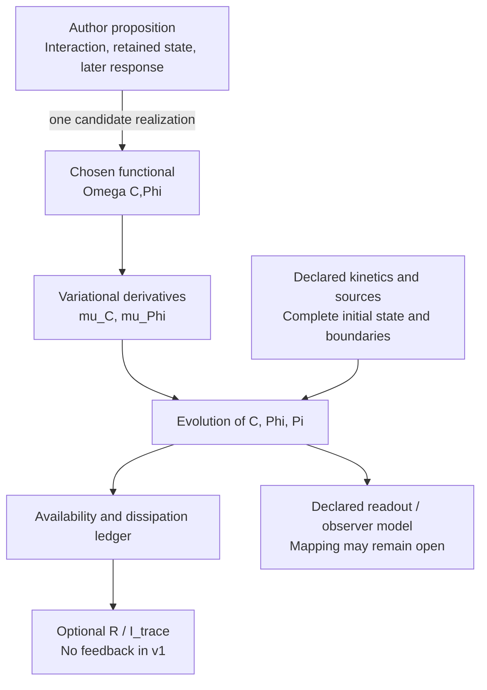
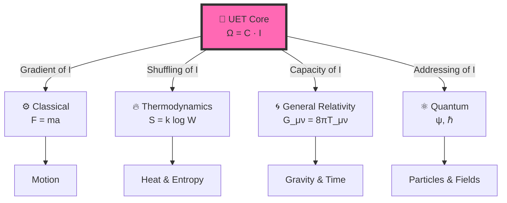

# 🔬 Unity Equilibrium Theory (UET) v0.9.0: The "Thermodynamics of Ethics" Framework

> **สถานะที่ตรวจ 23 ตุลาคม 2026:** งานล่าสุดแยกได้ว่าอะไรเป็นข้อเสนอ อะไรเป็นแบบจำลอง และรูปสมการใดใช้แทนกันได้ภายใต้เงื่อนไข ผลยังเป็น **FORMAL / normalized** ไม่ใช่การยืนยันฟิสิกส์ใหม่หรือแม่บทเดียวที่ปิดทุกสาขา อ่าน [อัปเดตงานวิจัยล่าสุด](#research-updates-2026-10-23) ก่อนใช้ป้ายและตารางประวัติด้านล่าง


> **"The universe is not just physics; it is a moral negotiation. Ω (Balance) is the goal . C (Connection) is the vehicle. I (Isolation) is the cost."**

---

## 📋 Table of Contents

- [🔬 Unity Equilibrium Theory (UET) v0.9.0: The "Thermodynamics of Ethics" Framework](#-unity-equilibrium-theory-uet-v090-the-thermodynamics-of-ethics-framework)
  - [📋 Table of Contents](#-table-of-contents)
  - [อัปเดตงานวิจัยล่าสุด — 23 ตุลาคม 2026](#research-updates-2026-10-23)
    - [ข้อเสนอรวมและเจตนาของผู้เขียน](#research-author-intent)
    - [สมการแกนของ realization ปัจจุบัน](#research-current-realization)
    - [แผนที่บทบาทของเทอม](#research-term-roles)
    - [ความสัมพันธ์ระหว่างรูปสมการ](#research-equation-relations)
    - [ผลล่าสุดทั้งด้านที่ผ่านและไม่ผ่าน](#research-bounded-results)
    - [ช่องว่างและโจทย์ถัดไป](#research-open-questions)
    - [หลักฐานและการทำซ้ำ](#research-evidence-boundary)
  - [🌍 The "Big Picture" Dashboard: 31 Solutions](#-the-big-picture-dashboard-31-solutions)
    - [🏆 1. Mathematical Breakthroughs (The Millennium Problems)](#-1-mathematical-breakthroughs-the-millennium-problems)
    - [🌌 2. The "Impossible" Physics Anomalies](#-2-the-impossible-physics-anomalies)
    - [⚔️ 3. Bridging Theoretical Conflicts](#️-3-bridging-theoretical-conflicts)
    - [❤️ 4. Impact on Humanity (Cross-Disciplinary)](#️-4-impact-on-humanity-cross-disciplinary)
  - [🎯 6. The Core Equation (Detailed Explanation)](#-6-the-core-equation-detailed-explanation)
    - [Current model formulation / แบบจำลองแกนปัจจุบัน](#current-master-equation)
      - [Functional and terms / Functional และเทอม](#current-master-functional)
      - [Complete state and evolution / สถานะครบและพลวัต](#current-master-dynamics)
      - [Where did I go? / I ไปอยู่ตรงไหน?](#current-master-information)
      - [Model complexity / ความซับซ้อน](#current-master-complexity)
      - [Research evidence / หลักฐาน](#current-master-evidence)
      - [Dependency map / แผนที่ความสัมพันธ์](#current-master-dependency-map)
    - [The Vision](#the-vision)
    - [The Full Implementation (Field Equation)](#the-full-implementation-field-equation)
    - [Why This Works (The Tree of Physics)](#why-this-works-the-tree-of-physics)
  - [📊 7. Test Results (v0.9.0)](#-7-test-results-v090)
    - [Summary](#summary)
    - [What We Validated](#what-we-validated)
    - [Run It Yourself](#run-it-yourself)
  - [🚀 8. Quick Start (Research Workspace)](#-8-quick-start-research-workspace)
    - [1. Installation](#1-installation)
    - [2. Usage Examples](#2-usage-examples)
    - [3. Run Verify Test](#3-run-verify-test)
  - [📚 9. Complete Topic Index (38+ Domains)](#-9-complete-topic-index-38-domains)
  - [🔍 10. Methodology](#-10-methodology)
    - [Human + AI Collaboration](#human--ai-collaboration)
    - [Transparency](#transparency)
  - [📄 Key Files](#-key-files)
  - [❓ Questions Answered by UET (SEO \& Key Research)](#-questions-answered-by-uet-seo--key-research)
  - [🏷️ Scientific Keywords \& Tags](#️-scientific-keywords--tags)
  - [ภาคผนวก: ถ้อยคำที่ปรับในรอบนี้](#readme-wording-history)

---

<a id="research-updates-2026-10-23"></a>
## อัปเดตงานวิจัยล่าสุด

> **ขอบเขตชุดเผยแพร่:** รอบนี้เผยแพร่เฉพาะสาม README และ WORK_LEDGER ไม่รวมงานวิจัย/PR ค้าง การตรวจ availability อ้าง main `d0210c00b63398f70e1f8f285a6daf5169645933` ชื่อแหล่งที่กำกับ **working-only** เป็นหลักฐานใน workspace ไม่ใช่ลิงก์ที่เปิดได้จาก public main จึงแสดงเป็นชื่อแทน hyperlink; ไม่ได้ลบผลหรือยกระดับข้ออ้าง
>
> แหล่งที่ยังไม่รวม: `docs/meta/UET_THEORY_ARGUMENT.md` (§§23–25), `docs/topics/0.13_Thermodynamic_Bridge/calculation_contracts/energy_memory_cycle.json` และ `docs/meta/UET_RESEARCH_RETROSPECTIVE.md` ชุด source/verifier ที่รายงานอ้างยังต้องมี publication review แยก ส่วน pending curved 3+1 narrative/artifacts คงไว้ใน workspace เดิม ไม่ถูกพามาในชุดนี้

**วันตัดยอด: 23 ตุลาคม 2026** — สรุปจาก UET Theory Argument (working-only) โดยเฉพาะ §§23–25 ที่บันทึกใน **local source commit `1346edfc07c2d2f9eb2adbd5257e820fa186a37b`** บน branch `codex/research/source-backaction-discrimination` ข้อความใหม่นี้เป็น documentation update ไม่ใช่ release ใหม่ และไม่ได้ตรวจยืนยันว่า public `main` ตรงกับชุดนี้แล้ว

<a id="research-author-intent"></a>
### 1. ข้อเสนอรวมและเจตนาของผู้เขียน

ภาพรวมที่ต้องการศึกษาคือ **ระบบซ้อนระบบ → ปฏิสัมพันธ์และการแลกเปลี่ยนพลังงาน → ผลที่คงอยู่ในสถานะ/โครงสร้าง/ความสัมพันธ์ → การตอบสนองภายหลังที่เปลี่ยนไป** ไม่ใช่การเรียกทุกสิ่งว่า information ก้อนเดียว การสังเกตเป็นปฏิสัมพันธ์ของระบบผู้วัดอีกส่วนหนึ่ง จึงต้องแยก source, signal transport, detector state, readout และ backaction ตามขอบเขตจริง

ข้อเสนอว่า **จักรวาลเป็นระบบเปิด มีการปรับตัวและ persistence** ยังเก็บไว้เป็นสมมติฐานระดับจักรวาลของผู้เขียน การตรวจ subsystem ที่เปิดไม่พิสูจน์สมมติฐานนี้ และเราไม่ลดความหมายของข้อเสนอให้เหลือเพียง subsystem โดยเงียบ ๆ ดูสายเหตุผลและการแยกที่มาใน รายงาน §3 (working-only)

ต้องอ่านสามชั้นแยกกัน: **เจตนาผู้เขียน**, **ผลจากทฤษฎีภายนอกพร้อมเงื่อนไขที่นำเข้า** และ **constitutive/model choices ที่ AI เสนอหรือใส่ใน implementation** การเห็นด้วยกับคำอธิบายไม่ใช่การรับรองสมการ ส่วนรายชื่อ “เจ็ดฐาน” ที่ยังยืนยันต้นทางไม่ครบไม่ถูกแทนด้วยเจ็ดเทอมหรือจำนวน axioms

<a id="research-current-realization"></a>
### 2. สมการแกนของ realization ปัจจุบัน

สำหรับสายล่าสุด แกนคือ **functional `Omega[C,Phi]` ร่วมกับ complete state `(C,Phi,Pi)` และกฎวิวัฒน์/kinetics, sources, initial/boundary data และ readout** ไม่ใช่ Omega เพียงตัวเดียว `matter_space_coupled_v1` เป็น **opt-in normalized prototype**; ค่า default ยังเป็น `legacy_local` การรัน legacy entrypoint โดยไม่ล็อก mode จึงไม่เท่ากับทดสอบ realization ล่าสุด

อ่านสูตรและความหมายใน [Core README](docs/core/README.md#current-response-realization), [spec](docs/core/01_contracts/MATTER_SPACE_RESEARCH_SPEC.md) และ relationship audit §25.2 (working-only) การเลือก functional และ kinetic law เป็นคนละขั้น: อนุพันธ์ของ functional ตามได้เมื่อเลือกมันแล้ว แต่ไม่ใช่หลักฐานว่าธรรมชาติบังคับให้เลือก polynomial หรือ coefficient เหล่านี้

ยังไม่มี transformation/derivation ที่ปิดว่า legacy C/I, dissipative C/Phi/Pi, covariant parent และทุก topic เป็นกฎเดียวกัน [Compatibility decision](docs/core/07_artifacts/gates/uet_foundation_compatibility_decision.json) ยังคง `FOUNDATION_NOT_CLOSED`; ผลของสายนี้ไม่เปลี่ยน gate ของ curved 3+1 หรือ O(2) อีกสายหนึ่ง

<a id="research-term-roles"></a>
### 3. แผนที่บทบาทของเทอม

| กลุ่ม | หน้าที่ในขอบเขตที่ประกาศ | สิ่งที่ยังห้ามเหมารวม |
| --- | --- | --- |
| State: C; legacy I; Phi, Pi | C เป็น coordinate ของสภาพระบบ; I เป็น state ใน legacy C/I; Phi เป็น effective response และ Pi=Phi_t | C ไม่ใช่มวลสากล; I ไม่ใช่ Phi หรือ Shannon information อัตโนมัติ |
| Coefficients: a, b, kappa, g, beta | รูปร่าง functional, spatial cost และ coupling ตามแต่ละ family | ชื่อเหมือนกันไม่ทำให้ origin/หน่วยเท่ากัน; normalized beta ไม่ใช่ inverse temperature |
| Functional derivatives: mu_C, mu_Phi | อนุพันธ์ของ functional ที่เลือก เป็น input ของกฎวิวัฒน์ | ไม่ใช่พลังงานก้อนใหม่ และไม่เลือก kinetic law เอง |
| Kinetics: M, tau และ operators | mobility, relaxation/inertia และการเลือก conserved/nonconserved dynamics | ใช้ Omega เดียวกันก็ให้ dynamics ต่างกันได้ |
| Sources: J_C, J_Phi และ boundary ports | การขับ/แลกเปลี่ยนตาม operator และบัญชีงานที่ประกาศ | additive source, conjugate force และ traction ใช้บัญชีงานแทนกันไม่ได้ |
| Ledger: E และ sigma | extended normalized availability และ dissipation ที่ derive ภายใน model | E ไม่ใช่ Omega อย่างเดียวเมื่อมี Pi; ยังไม่ใช่ SI energy, heat หรือ entropy โดยอัตโนมัติ |
| Trace: R / I_trace | derived causal/history output จาก sigma; ไม่มี feedback ใน v1 | ไม่ใช่ independent state, แหล่งพลังงาน หรือข้อมูลทั้งหมดของระบบ |
| Observer record | ค่าที่ได้จาก measurement/processing operator และสถานะผู้วัด | ไม่ใช่ตัวระบบต้นทาง และยังไม่ถือว่า internal states สังเกตได้ครบ |

รายละเอียด/ต้นทางอยู่ใน §25.3 (working-only) ไม่ได้สร้างทะเบียนสมการซ้ำใน README

<a id="research-equation-relations"></a>
### 4. ความสัมพันธ์ระหว่างรูปสมการ

| ประเภท | ตัวอย่างและเงื่อนไข | ข้อจำกัด |
| --- | --- | --- |
| Exact rewrite | Phi_t=Pi กับสมการ Pi เขียนเป็น second-order Phi ได้เมื่อเก็บ initial Phi และ Pi เดิม | ไม่ใช่กลไกใหม่เพราะเปลี่ยนรูปเขียน |
| Coordinate transformation | smooth invertible map พร้อมแปลง generator, mobility, sources และ readout ครบ | C^2 ไม่ invertible ข้ามสองเครื่องหมาย; เปลี่ยนพิกัดไม่คง constant mobility เอง |
| Conditional reduction | stationary elimination หรือ overdamped/adiabatic limit ใน regime ที่ตรวจแล้ว | tau→0 ยังเป็น evolution ไม่ใช่ mu_Phi=0; static elimination ไม่เก็บ prepared history ทั้งหมด |
| Alternative model | conserved กับ nonconserved C; legacy C/I กับ response C/Phi/Pi | ต่าง operators, coupling และ admissible initial data ไม่ใช่แค่เปลี่ยนชื่อ |
| Unresolved bridge | เชื่อมทุก family หรือแมป normalized state ไป observable/หน่วยจริง | ต้องมี correspondence และ error budget ไม่ใช้ชื่อ information เป็นหลักฐาน |

ในตัวอย่าง C/I coupling เป็น `beta*C*I` แต่ C/Phi/Pi ใช้ `-g*C^2*Phi/2` การแทน I=r*Phi ด้วยค่าคงที่ไม่ทำให้สอง coupling เท่ากันทุก C เมื่อ couplings ไม่เป็นศูนย์ ส่วน static elimination ของ I ให้ quadratic correction ของ C แต่ response Phi ให้ leading quartic correction เฉพาะเงื่อนไขที่ระบุ นี่เป็นความต่างของ model choices ไม่ใช่ข้อสรุปว่าผู้เขียนต้องเลือกแบบใด ดู ข้ออนุมาน/ข้อจำกัด §25.4 (working-only) และ ตาราง §25.5 (working-only)

<a id="research-bounded-results"></a>
### 5. ผลล่าสุดทั้งด้านที่ผ่านและไม่ผ่าน

| หลักฐาน | Comparator / protocol | ผลและขอบเขต |
| --- | --- | --- |
| §23.3 steady-response certificate (working-only) | raw first-mode approximation เทียบ full normalized linear rod–polarization reference; steady harmonic endpoint force F_b, f_P=0, omega/omega_0 ใน [0.99,1.01] และ fixed controls ตาม card | complex transfers p/F_b และ x/F_b มี uniform relative-error bound ≤18511/2066610 <0.9%<1% **เทียบแบบจำลองเต็ม ไม่ใช่ความแม่นยำกับธรรมชาติ** ไม่ครอบ arbitrary inputs, DC, finite settling/preparation หรือบัญชีพลังงานทุกชนิด |
| §24.6 prepared-history limitation (working-only) | smooth finite-energy write + controlled wait + released read ใน reference เดิม; projected (p,q0,q0dot) เท่ากับ baseline แต่ higher modes ต่าง | state ย่อไม่พอสำหรับ preparation/read class นี้; normalized endpoint witness 0.002177<x(t_r)/epsilon<0.002187 พร้อม tail bound ไม่ใช่อนาคตต่างจาก complete state เดียวกัน ไม่ปฏิเสธทุก reduction และไม่ใช่ physical memory/learning validation |
| §25 relationship audit (working-only) | ตรวจ source/registry, exact algebra 8 กลุ่ม และ default-mode AST; ใช้ผลเดิม ไม่รัน solver เก่าใหม่ | แยก generator/kinetics/state/ledger/output และข้อเชื่อม exact/conditional/alternative ได้ ยังไม่รวมทุก family เป็น universal master หรือพิสูจน์สูตรทั้ง registry |

ผลผ่านของ §23 และข้อจำกัดของ §24 อยู่ร่วมกันได้เพราะคนละ protocol กลไก retained modes ใน comparator มาตรฐานอธิบายผลเหล่านี้ได้อยู่แล้ว จึงยังไม่ใช่หลักฐาน UET-specific new mechanics, global openness หรือการแปลงข้อมูลเป็นพลังงานจริง

<a id="research-open-questions"></a>
### 6. ช่องว่างและโจทย์ถัดไป

ยังต้องปิด **physical mapping/หน่วย, parameter origins, preparation, source/detector/measurement uncertainty และข้อจำกัดที่ UET เพิ่มเหนือ comparator** การมี audit เอกสารหรืออนุพันธ์ที่ถูกภายใน model ไม่ปิดช่องเหล่านี้ Thermal-ledger helper bug ที่รายงานเดิมพบยังต้องแยกซ่อมและตรวจ claims ที่พึ่งมัน ไม่ถือว่ารอบ README นี้ซ่อมแล้วหรือใช้ตัดสินงานที่ไม่พึ่งมัน

โจทย์ถัดไปจาก §25.7 (working-only) คือระบุหนึ่งสถานการณ์ที่ตั้งใจศึกษา: **ผลคงอยู่ต้องจำเพียงขนาด หรือจำทิศ/เครื่องหมายด้วย และเข้าไปเปลี่ยนการตอบสนองผ่าน state/input ใด?** ใช้คำตอบตรวจ realization เดิมที่ตรง scope; ไม่เพิ่มเทอม รันวัสดุใหม่ หรือปรับ optimizer เพื่อหนี comparator คำตอบของผู้เขียนยืนยันเจตนา ไม่ใช่หลักฐานทางฟิสิกส์

<a id="research-evidence-boundary"></a>
### 7. หลักฐานและการทำซ้ำ

เริ่มจาก รายงานรวม (working-only), [Core spec](docs/core/01_contracts/MATTER_SPACE_RESEARCH_SPEC.md), [equation registry](docs/core/07_artifacts/correspondence/uet_equation_correspondence_registry.json), [foundation gate](docs/core/07_artifacts/gates/uet_foundation_dependency_gate.json) และ [Topic 13 full bridge gate](docs/topics/0.13_Thermodynamic_Bridge/Result/artifacts/topic13_full_thermodynamic_bridge_core_ready_gate.json) gate สุดท้ายยังแยก legacy graphite/TTG ที่ `BLOCKED_OPEN_T13_FULL_BRIDGE` จาก O(2)/He-4 ที่ Core-ready; ไม่ใช่ external validation

เส้นทาง cycle ใช้ contract T13_ENERGY_MEMORY_CYCLE_FORMAL_V1 (working-only): review `INCOMPLETE`, physical correspondence `UNKNOWN` และรับรองเฉพาะ scope นั้น ไม่รับรองทุก family อ่านประวัติที่ [Topic 13 UPDATE_LOG](docs/topics/0.13_Thermodynamic_Bridge/UPDATE_LOG.md) และ [WORK_LEDGER วันที่ 23 ต.ค.](WORK_LEDGER/2026/2026-10-23.md)

**Working evidence ≠ local commit ≠ public main:** ชุด source commit ที่ระบุมีรายงาน §§23–25 แต่ยังไม่ใช่ complete publication packet: retrospective และ source/verifier สามไฟล์ที่รายงานอ้างยังไม่อยู่ใน tree ของ commit นี้ แม้เปิดได้ในเครื่อง จึงไม่กล่าวว่าผู้อ่านภายนอกทำซ้ำงานเก่าทุกชิ้นได้ครบ และไม่ได้อนุมานสถานะ remote ล่าสุดโดยไม่ตรวจ ลิงก์ retrospective ที่คงจากประวัติต้องอ่านพร้อมข้อจำกัดนี้; ดูรายละเอียด source identity/publication gaps ในรายงานก่อนอ้างซ้ำ

---

## 📁 Project Structure

> **Important:** All research code, engines, and data live inside `docs/` — this folder serves dual purpose as both the **GitHub Pages source** and the **main research codebase**.

```
uet_harness/
├── docs/                          ← 🔬 Research Portal (GitHub Pages + Python Package)
│   ├── __init__.py                ← Python package entry: `import docs as uet`
│   ├── _config.yml                ← Jekyll config for GitHub Pages
│   ├── core/                      ← UET Master Equation & core solvers
│   ├── topics/                    ← 📚 All 38 research topics (engines, proofs, data)
│   │   ├── 0.0_Grand_Unification/ ← Omni Engine (imports all sub-engines)
│   │   ├── 0.1_Galaxy_Rotation/   ← Each topic follows the same structure:
│   │   │   ├── Code/01_Engine/    │     Engine (solver)
│   │   │   ├── Code/02_Proof/     │     Mathematical proofs
│   │   │   ├── Code/03_Research/  │     Experiments & validation
│   │   │   ├── Data/              │     Reference datasets
│   │   │   ├── Result/            │     Output figures & logs
│   │   │   ├── Doc/               │     Documentation & papers
│   │   │   └── README.md          │     Topic overview
│   │   └── ...                    ← Topics 0.2 through 0.39
│   ├── knowledge_base/            ← Vector store & tensorizer
│   ├── scripts/                   ← Runners, audits, data tools
│   └── Docs/                      ← Framework standards & guides
├── uet_history/                   ← Historical notes and prior UET writing archive
├── .github/                       ← Repository automation and GitHub metadata
├── CITATION.cff                   ← Citation metadata
├── CONTRIBUTING.md                ← Contribution notes
├── LICENSE                        ← MIT license
└── README.md                      ← Project overview
```

> **Note:** The `docs/` folder was previously named `research_uet/`. All internal paths have been updated. If you find outdated references, please open an issue.

> **Current Repository Scope:** This repository is the main UET research corpus. The source-only prototypes under services_and_experiments/ are retained as a future platform layer, but they are not required for research, books, or policy work and are not a live application, mining network, or production knowledge service. The design intent is preserved as roadmap/prototype context.

---

<a id="-the-big-picture-dashboard-31-solutions"></a>
## 🌍 The "Big Picture" Dashboard: 38 Solutions

UET retains a **"Civilization-Level Operating System"** vision across 6 domains; the entries below are historical research claims and proposed applications, not established solutions.

> **Research Status Note:** The dashboard keeps the original UET vision and claim map intact, but readers should treat the items as research claims, proposed mechanisms, prototype validations, or roadmap targets unless a specific script, dataset, or report in `docs/` is cited and independently reproduced.

### 🏆 1. Mathematical Breakthroughs (The Millennium Problems)
*Historical proposal: interpret abstract math problems through physical manifold geometry; no general proof is established by this dashboard.*

| Problem | Status | UET Solution | Topic |
|:--------|:-------|:-------------|:------|
| **Navier-Stokes** | Historical claim / ยังไม่ทบทวนข้ออ้างนี้ | Turbulence is smooth ($C^\infty$) on 4D Manifold | [0.10 Fluid Dynamics](./docs/topics/0.10_Fluid_Dynamics_Chaos/) |
| **Yang-Mills Gap** | Historical claim / ยังไม่ทบทวนข้ออ้างนี้ | Mass arises from Information geometric limits | [0.21 Yang-Mills](./docs/topics/0.21_Yang_Mills_Mass_Gap/) |
| **P vs NP** | Historical claim / ยังไม่ทบทวนข้ออ้างนี้ | P=NP via Manifold Connectivity Optimization | [0.18 Mathnicry](./docs/topics/0.18_Mathnicry/) |
| **Riemann Hyp.** | **Mapped** | Zeros are Resonance Frequencies of the I-Field | [0.18 Mathnicry](./docs/topics/0.18_Mathnicry/) |

### 🌌 2. The "Impossible" Physics Anomalies
*Historical anomaly interpretations follow; this page does not establish a proof or a replacement for the standard explanations.*

| Anomaly | The Crisis (Topic 0.1 Evidence) | UET Solution (Topic 0.26 Mechanism) | Status |
|:--------|:--------------------------|:------------------------------------|:-------|
| **Dark Matter** | Galaxies spin too fast ([Topic 0.1](./docs/topics/0.1_Galaxy_Rotation_Problem/)) | **Dynamic Viscosity**: Space acts as a fluid with drag $a_0$ ([Topic 0.26](./docs/topics/0.26_Cosmic_Dynamic_Frame/)) | Historical claim / ยังไม่ทบทวนข้ออ้างนี้ |
| **Dark Energy** | Universe explodes | Info Field Cutoff (Finite $\Lambda$) | [0.12 Vacuum Energy](./docs/topics/0.12_Vacuum_Energy_Casimir/) |
| **Hubble Tension** | $H_0$ mismatch (5$\sigma$) | Dynamic Entropy Scaling ($H(t)$) | [0.3 Cosmology](./docs/topics/0.3_Cosmology_Hubble_Tension/) |
| **Muon g-2** | 4.2$\sigma$ deviation | Geometric Topology Correction | [0.8 Muon g-2](./docs/topics/0.8_Muon_g2_Anomaly/) |
| **Neutrino Mass** | Massive but Ghostly | Geometric Information Drag | [0.7 Neutrino Physics](./docs/topics/0.7_Neutrino_Physics/) |

### ⚔️ 3. Bridging Theoretical Conflicts
*Harmonizing the "War of Physics".*

| Conflict | The Divide | Historical UET interpretation | Topic |
|:---------|:-----------|:-----------------|:------|
| **Gravity vs Quantum** | Smooth vs Discrete | Gravity = Quantum Entropy Pressure | [0.19 Gravity & GR](./docs/topics/0.19_Gravity_GR/) |
| **Locality vs Bell** | Local vs Spooky | Non-local Potential Reservoir | [0.9 Quantum Bell](./docs/topics/0.9_Quantum_Nonlocality/) |
| **Order vs Chaos** | Determinism vs Luck | Chaos is just High-Dim Order | [0.10 Fluid Dynamics](./docs/topics/0.10_Fluid_Dynamics_Chaos/) |
| **Life vs Entropy** | Decay vs Growth | Life = Negentropy Engine | [0.22 Origin of Life](./docs/topics/0.22_Biophysics_Origin_of_Life/) |

### ❤️ 4. Impact on Humanity (Cross-Disciplinary)
*Why this matters to your life, your wallet, and your future.*

| Domain | Benefit | UET Insight | Topic |
|:-------|:--------|:------------|:------|
| **Economics** | Checkmate Crises | Market Crash = Info Avalanches | [0.25 Strategy](./docs/topics/0.25_Strategy_Power_Economics/) |
| **AI Safety** | Alignment | Consciousness = Info Resonance | [0.24 AI Core](./docs/topics/0.24_Artificial_Intelligence/) |
| **Biology** | Health/Genetics | DNA = Error Correction Code | [0.22 Biophysics](./docs/topics/0.22_Biophysics_Origin_of_Life/) |
| **Energy** | Infinite Power | Room-Temp Superconductivity | [0.4 Superconduct](./docs/topics/0.4_Superconductivity_Superfluids/) |
| **Energy** | Clean Fusion | p-B11 Resonant Confinement | [0.32 Fusion](./docs/topics/0.32_Micro_Nuclear_Fusion/) |
| **Computing** | Quantum Leap | 99.99% Fidelity Gates | [0.18 Mathnicry](./docs/topics/0.18_Mathnicry/) |
| **Medicine** | Cold Light | Trapping Light for Holograms/Imaging | [0.27 Cold Light](./docs/topics/0.27_Cold_Light_Hologram/) |
| **Material** | Zero Mining | Graphene from Carbon Waste | [0.28 Material](./docs/topics/0.28_Material_Synthesis/) |
| **Manufacturing**| Atomic Precision | Info-Centric Nanofabrication | [0.34 Nanofab](./docs/topics/0.34_Information_Centric_Nanofabrication/) |
| **Manufacturing**| Digital Twin | Logic-Driven Automation | [0.35 Automation](./docs/topics/0.35_ICN_Digital_Automation/) |
| **Space Ind.** | Zero-G Factory | Orbital Foundry Systems | [0.36 Orbital](./docs/topics/0.36_Orbital_Manufacturing/) |
| **Environment** | Ocean Shield | Reverse Ocean Acidification | [0.29 Ocean](./docs/topics/0.29_Ocean_Recovery/) |
| **Agriculture** | Mega Flora | Acoustic Nutrient Injection | [0.30 Mega Flora](./docs/topics/0.30_Mega_Flora_Biotech/) |
| **Space** | Warp Drive | Reach 0.1c via Singularities | [0.31 Propulsion](./docs/topics/0.31_SpaceTime_Propulsion/) |
| **Energy** | Universal Capture| Quantum Solar Paint | [0.37 Solar Paint](./docs/topics/0.37_Quantum_Photovoltaics/) |

---

## 🎯 6. The Core Equation (Detailed Explanation)

<!-- UET-CURRENT-MASTER-PRESENTATION:START -->
<a id="current-master-equation"></a>
### Current model formulation / แบบจำลองแกนปัจจุบัน

**EN — What is presented here:** an existing candidate realization of UET's interaction–retained-state–later-response proposal, not a newly derived universal law. In the current response lane, the calculational core is **a functional plus a complete state and declared evolution laws**. The historical `Omega = C·I` vision is preserved below, but it is not the complete equation used for these calculations.

**TH — ส่วนนี้นำเสนออะไร:** realization ที่มีอยู่แล้วของข้อเสนอเรื่องปฏิสัมพันธ์ ผลคงอยู่ และการตอบสนองภายหลัง ไม่ใช่การประกาศกฎสากลที่ derive ใหม่ แกนคำนวณของสาย response คือ **functional พร้อมสถานะครบและกฎวิวัฒน์ที่ประกาศ** ส่วนวิสัยทัศน์ `Omega = C·I` เดิมเก็บไว้ด้านล่าง แต่ไม่ใช่สมการคำนวณครบชุดของงานนี้

> **Scope / ขอบเขต:** `matter_space_coupled_v1`; normalized 1D prototype; opt-in; physical correspondence remains open. The engine default is still `legacy_local`. / แบบจำลองหนึ่งมิติแบบ normalized ที่ต้องเลือกเปิดใช้เอง ยังไม่ปิดการแมปกายภาพ และไม่เปลี่ยน default ของ engine

**EN — Intended proposition:** interactions may leave persistent changes in a system's state, structure or correlations; those changes may affect a later response. This realization investigates one state-mediated mechanism. It does not establish that every retained change is one scalar information quantity, nor does subsystem openness establish the author's global-open-universe hypothesis.

**TH — ข้อเสนอที่ตั้งใจศึกษา:** ปฏิสัมพันธ์อาจทิ้งผลคงอยู่ในสถานะ โครงสร้าง หรือความสัมพันธ์ของระบบ และผลนั้นอาจเปลี่ยนการตอบสนองครั้งต่อไป realization นี้ศึกษากลไกผ่านสถานะหนึ่งแบบ ไม่ถือว่าผลคงอยู่ทั้งหมดต้องเป็นข้อมูล scalar ตัวเดียว และไม่ใช้ความเปิดของ subsystem ยืนยันสมมติฐานจักรวาลเปิดทั้งหมดของผู้เขียน

<a id="current-master-functional"></a>
#### Functional and term structure / Functional และโครงสร้างเทอม

$$
\boxed{
\begin{aligned}
\Omega[C,\Phi]=\int\Big[&
\frac{a_C}{2}C^2+\frac{b_C}{4}C^4
+\frac{\kappa_C}{2}|\nabla C|^2\\
&+\frac{a_\Phi}{2}\Phi^2+\frac{b_\Phi}{4}\Phi^4
+\frac{\kappa_\Phi}{2}|\nabla\Phi|^2
-\frac{g}{2}C^2\Phi
\Big]\,dx
\end{aligned}}
$$

| Part / ส่วน | Mathematical role / หน้าที่ | Interpretation boundary / ขอบเขตการตีความ |
| --- | --- | --- |
| `a_C C²/2 + b_C C⁴/4` | Local landscape of the system-state coordinate / รูปร่าง functional เฉพาะที่ของสถานะระบบ | Chosen polynomial, not a derivation of matter or existence / เป็น polynomial ที่เลือก ไม่ใช่ derivation ของสสารหรือการมีอยู่ |
| `a_Phi Phi²/2 + b_Phi Phi⁴/4` | Local response landscape / รูปร่าง functional ของการตอบสนอง | Effective response, not a metric or information substance / ไม่ใช่ metric หรือสารข้อมูล |
| `kappa_C*norm(grad C)²/2`, `kappa_Phi*norm(grad Phi)²/2` | Spatial-gradient contributions / ส่วนที่ขึ้นกับความต่างเชิงพื้นที่ | Not, by themselves, a complete temporal-memory law / ไม่ใช่กฎความจำตามเวลาที่ครบแล้ว |
| `-g C² Phi/2` | Coupling between the two sectors / เทอมเชื่อมสองส่วน | Constitutive choice; its form and value are not fixed by the word information / เป็นการเลือกแบบจำลอง ไม่ได้ถูกบังคับด้วยคำว่าข้อมูล |

**EN:** `a,b,kappa,g` describe the selected normalized landscape and coupling; `M,tau` below describe kinetics and response time. Their numerical defaults are benchmark controls, not universal physical constants. The polynomial form, coupling and kinetics are model choices; their variational derivatives can then be derived within that model. A correct derivative does not retrospectively derive the choice of functional.

**TH:** `a,b,kappa,g` กำหนดรูปร่าง functional และ coupling แบบ normalized ส่วน `M,tau` ด้านล่างกำหนด kinetics และเวลาตอบสนอง ค่า default เป็น benchmark controls ไม่ใช่ค่าคงที่สากล รูป polynomial, coupling และ kinetics เป็นสิ่งที่เลือกในแบบจำลอง แล้วจึงหาอนุพันธ์ตามมาได้ การหาอนุพันธ์ถูกไม่ใช่การพิสูจน์ย้อนหลังว่าธรรมชาติต้องเลือก functional นี้

<a id="current-master-dynamics"></a>
#### Complete state and evolution / สถานะครบและกฎวิวัฒน์

$$
\mu_C=\frac{\delta\Omega}{\delta C},
\qquad
\mu_\Phi=\frac{\delta\Omega}{\delta\Phi},
\qquad
\text{state}=(C,\Phi,\Pi).
$$

$$
\partial_t C=
\begin{cases}
M_C\nabla^2\mu_C+J_C & \text{conserved lane},\\
-M_C\mu_C+J_C & \text{nonconserved control},
\end{cases}
$$

$$
\partial_t\Phi=\Pi,
\qquad
\tau_\Phi\partial_t\Pi+\Pi=-M_\Phi\mu_\Phi+J_\Phi.
$$

**EN:** choose one C law for the declared calculation; the two lines are alternatives, not simultaneous updates or mere numerical methods. The conserved lane preserves the declared integral when its source has zero net integral. Each spatial position has three state coordinates; the whole field is not just three numbers. Initial `C,Phi,Pi`, sources, coefficients and periodic/zero-flux boundaries must be specified. `Pi` is the rate paired with `Phi`, not a third substance: writing a second-order response as a first-order pair preserves its independent initial rate.

**TH:** ต้องเลือกกฎ C หนึ่งแบบต่อการคำนวณ สองบรรทัดเป็นทางเลือก ไม่ใช่ใช้พร้อมกันหรือแค่เปลี่ยนวิธีคำนวณ แบบ conserved รักษาอินทิกรัลที่ประกาศเมื่อ source มีอินทิกรัลสุทธิเป็นศูนย์ แต่ละตำแหน่งมีสาม state coordinates ไม่ใช่ว่าทั้งสนามมีแค่สามตัวเลข ต้องระบุค่าเริ่มต้น `C,Phi,Pi`, sources, coefficients และขอบเขต periodic/zero-flux ส่วน `Pi` เป็นอัตราการเปลี่ยนที่คู่กับ `Phi` ไม่ใช่สารชนิดที่สาม การเขียนสมการอันดับสองเป็นคู่สมการอันดับหนึ่งยังต้องเก็บอัตราเริ่มต้นเดิม

**EN — Ledger, not another independent field:** the selected kinetics gives the extended normalized availability below. With the declared constant coefficients, boundary conditions and additive-source convention, its continuum balance separates dissipation from source work; a finite numerical step still needs its own error check. `P_C = integral mu_C J_C dx` and `P_Phi = integral Pi J_Phi/M_Phi dx`; a force/traction port needs its own matching, not the same formula by name.

**TH — บัญชี ไม่ใช่ field อิสระเพิ่ม:** kinetics ที่เลือกให้ extended normalized availability ด้านล่าง ภายใต้ coefficients คงที่ เงื่อนไขขอบเขต และ additive-source convention ที่ประกาศ บัญชี continuum แยก dissipation ออกจากงานของ source ส่วนผลรันที่ใช้ time step จำกัดยังต้องตรวจ error ของตัวเอง โดย `P_C = integral mu_C J_C dx` และ `P_Phi = integral Pi J_Phi/M_Phi dx` ถ้าใช้ force/traction port ต้องตรวจการจับคู่ใหม่ ไม่ใช่ยืมสูตรเพราะใช้ชื่อ source เหมือนกัน

$$
E=\Omega+\frac{\tau_\Phi}{2M_\Phi}\int\Pi^2\,dx,
\qquad
\frac{dE}{dt}=-\int(\sigma_C+\sigma_\Phi)\,dx+P_C+P_\Phi.
$$

**EN:** with zero sources this balance is non-increasing under its assumptions; it does not assert that `Omega` alone decreases in every driven/inertial run. `E,sigma` are not automatically joules, heat or thermodynamic entropy.

**TH:** เมื่อไม่มี sources บัญชีนี้ไม่เพิ่มภายใต้สมมติฐานของมัน ไม่ได้กล่าวว่า `Omega` อย่างเดียวต้องลดทุกรอบที่มีแรงขับหรือ inertia และยังไม่ถือว่า `E,sigma` เป็นจูล ความร้อน หรือ thermodynamic entropy อัตโนมัติ

<a id="current-master-information"></a>
#### Where did I go? / I ไปอยู่ตรงไหน?

| Symbol or context / ตัวแปรหรือบริบท | Role in the cited model / บทบาท | What it is not / สิ่งที่ไม่ใช่ |
| --- | --- | --- |
| Historical `I` in the Vision | Individualism/Isolation metaphor / คำตีความเชิงแนวคิด | Not a current universal definition of mass, information or latency / ไม่ใช่นิยามสากลปัจจุบันของมวล ข้อมูล หรือ latency |
| Legacy C/I field `I` | Independently initialized/evolving field that couples back to C / field ที่มีค่าเริ่มต้นและพลวัต พร้อม coupling กลับสู่ C | Not automatically Shannon information, entropy, Phi or I_trace / ไม่เท่ากับปริมาณเหล่านั้นโดยชื่อ |
| `C` | System-state coordinate with lane-specific mapping / coordinate ของสถานะที่ต้องแมปตาม lane | Not universally mass, light speed or energy / ไม่ใช่มวล ความเร็วแสง หรือพลังงานสากล |
| `Phi` / Φ (Phi, not Ψ/Psi) | Effective response coordinate in this realization / coordinate การตอบสนองของ realization นี้ | Not a renamed, fully equivalent legacy I or a completed information definition / ไม่ใช่ I เดิมที่พิสูจน์ว่าเท่ากันครบแล้ว |
| `Pi = Phi_t` | Response rate and initial datum / อัตราตอบสนองและค่าเริ่มต้นที่ต้องเก็บ | Not an information quantity merely because it retains dynamical history / ไม่เป็นปริมาณข้อมูลเพียงเพราะร่วมเก็บผลอดีต |
| `R / I_trace` and observer record | Derived dissipation trace and separately declared measurement output / ร่องรอยจาก dissipation กับผลอ่านที่ต้องประกาศแยก | Not complete state or all information; R has no feedback in v1 / ไม่ใช่สถานะครบหรือข้อมูลทั้งหมด และ R ไม่มี feedback ใน v1 |

**EN:** the legacy coupling is `beta*C*I`; the response coupling is `-g*C²*Phi/2`. They differ in state dependence and admissible initial data. With nonzero couplings and C held as the same coordinate, a constant rescaling `I=r*Phi` cannot make the full models identical. The C-to-Phi source uses C², so that source alone does not distinguish C's two signs; this is not a claim that every state or output loses sign. The information concept has not been disproved or silently moved into Phi: its mathematical correspondence remains a question to resolve.

**TH:** coupling เก่าคือ `beta*C*I` ส่วน response คือ `-g*C²*Phi/2` ซึ่งขึ้นกับสถานะและต้องการค่าเริ่มต้นต่างกัน เมื่อ coupling ไม่เป็นศูนย์และคง C เป็น coordinate เดิม การแทน `I=r*Phi` ด้วยค่าคงที่ไม่ทำให้ทั้งแบบจำลองเท่ากัน แรงขับจาก C ไป Phi ใช้ C² จึงไม่แยกสองเครื่องหมายผ่านช่องทางนี้อย่างเดียว ไม่ได้หมายความว่าทุกสถานะหรือทุก output สูญเครื่องหมาย แนวคิดข้อมูลไม่ได้ถูกพิสูจน์ว่าผิดหรือถูกย้ายเข้า Phi เงียบ ๆ แต่ยังต้องปิดความสัมพันธ์ทางคณิตศาสตร์ให้ชัด


**EN:** the historical three-term C/I sketch below is also shorter than the repaired legacy gradient-flow contract: that contract includes the I-gradient and quadratic I contributions. Its short display should not be mistaken for the full old model.

**TH:** สูตร C/I สามเทอมที่เก็บไว้ด้านล่างก็สั้นกว่า legacy gradient-flow contract ที่ตรวจแก้แล้วเช่นกัน เพราะ contract นั้นยังมีส่วน gradient ของ I และส่วน quadratic ของ I ภาพสั้นเดิมจึงไม่ใช่รายละเอียดครบของแบบจำลองเก่า

Sources / ต้นทาง: [response ontology and functional](docs/core/01_contracts/MATTER_SPACE_RESEARCH_SPEC.md), [implemented response operator](docs/core/02_equations/matter_space/uet_matter_space.py), [scoped legacy C/I compatibility audit](docs/core/08_history/research_notes/UET_FOUNDATION_COMPATIBILITY_AUDIT.md). The detailed relationship argument is working-only evidence at `docs/meta/UET_THEORY_ARGUMENT.md` §§25.2–5, local source commit `1346edfc07c2d2f9eb2adbd5257e820fa186a37b`; it is not included in the current public evidence packet. / รายงานความสัมพันธ์ละเอียดเป็นหลักฐานในเครื่องตาม path/commit นี้ ยังไม่รวมในชุดหลักฐานสาธารณะปัจจุบัน

<a id="current-master-complexity"></a>
#### Is it still simple? / ยังเรียบง่ายอยู่หรือไม่?

**EN:** it is a small coupled-field model in architecture, but not the two-symbol slogan. Compared with the scoped two-field C/I gradient flow, the response realization genuinely includes an independently prepared response rate. Compared with the old multi-option master implementation, this declared lane excludes exchange/game/will/layer additions that do not belong to its contract. More displayed lines do not all represent new assumptions, but a new state, coupling or kinetic law is a real modeling choice.

**TH:** โครงสร้างยังเป็นแบบจำลอง coupled fields ขนาดเล็ก แต่ไม่ใช่สโลแกนสองตัวอักษร เมื่อเทียบกับ scoped C/I gradient flow ที่มีสอง field สาย response เพิ่มอัตราตอบสนองที่เตรียมค่าเริ่มต้นได้อย่างอิสระจริง เมื่อเทียบกับ master implementation เก่าที่รวมหลาย options สายนี้ไม่เอา exchange/game/will/layer ที่อยู่นอก contract มาปน จำนวนบรรทัดที่มากขึ้นไม่ใช่สมมติฐานใหม่ทุกบรรทัด แต่การเพิ่ม state, coupling หรือ kinetic law คือการเลือกแบบจำลองเพิ่มจริง

| Layer / ชั้น | What is chosen or follows / อะไรเลือก อะไรตามมา | Research role / หน้าที่ |
| --- | --- | --- |
| Model assumptions / สมมติฐานแบบจำลอง | State meanings, functional, coupling, conservation, kinetics and coefficient origins / ความหมายสถานะ functional coupling conservation kinetics และที่มา coefficients | Must be justified and compared; not derived merely by writing Omega / ต้องมีเหตุผลและคู่เทียบ ไม่ได้ derive ด้วยการเขียน Omega |
| Mathematical consequences / ผลตามทางคณิตศาสตร์ | `mu_C,mu_Phi`, first/second-order rewrite and conditional ledger identities / อนุพันธ์ การเปลี่ยนรูปอันดับสมการ และบัญชีภายใต้เงื่อนไข | Supporting equations from selected premises, not independent new forces / สมการประกอบที่ตามจากฐานที่เลือก ไม่ใช่แรงใหม่ทุกตัว |
| Preparation and realization / การเตรียมและ realization | Initial/boundary data, drives, dimensional map and measurement model / ค่าเริ่มต้น ขอบเขต แรงขับ การแมปหน่วย และแบบจำลองการวัด | Further physical/input choices; some remain open / เป็นการเลือกหรืออินพุตเพิ่ม บางส่วนยังเปิด |
| Numerical and diagnostic layer / ชั้นคำนวณและ diagnostic | Discretization, solver, error checks, optional trace and protocol-specific projection / discretization solver error trace ทางเลือก และ projection ตาม protocol | Approximation/measurement choices must be assessed; they are not all automatic derivatives / ต้องตรวจความเหมาะสม ไม่ใช่ทั้งหมดตามมาอัตโนมัติ |
| Other equation families / สมการสายอื่น | Covariant parent, O(2), transport and other lanes retain their own contracts / แต่ละสายคง contract ของตัวเอง | Not all established as child equations of this functional / ยังไม่พิสูจน์ว่าทั้งหมดเป็นสมการลูกของ functional นี้ |

<a id="current-master-evidence"></a>
#### What the research supports / งานวิจัยรองรับอะไร

| Existing result / ผลเดิม | Decision within scope / สิ่งที่ตัดสินได้ | What does not follow / สิ่งที่ยังไม่ตามมา |
| --- | --- | --- |
| §23 steady-response comparison | A first-mode approximation has <0.9% relative-error bounds for complex `p/F_b` and `x/F_b` against the full normalized rod–polarization reference, for F_b-only steady forcing with f_P=0 and omega/omega_0 in [0.99,1.01] / ผ่านเกณฑ์เทียบแบบจำลองเต็มภายใต้แรงขับและย่านที่ตรึง | Not accuracy against nature, arbitrary inputs or preparation transients / ไม่ใช่ความแม่นยำกับธรรมชาติหรือทุกอินพุต |
| §24 prepared-history counterexample | A smooth finite-energy write / controlled wait / released read leaves higher-mode history outside the tested projected state `(p,q0,q0dot)` / สถานะย่อที่ทดสอบเก็บประวัติใน higher modes ไม่ครบ | Not different futures from an identical complete state; not new mechanics or learning validation / ไม่ใช่อนาคตต่างจากสถานะครบเดียวกันหรือการยืนยัน learning |
| §25 relationship audit | Exact rewrites, conditional reductions and alternative models are distinguished / แยกรูปเขียนเทียบเท่า การลดแบบมีเงื่อนไข และแบบจำลองทางเลือกได้ | Not a closed universal master or a proof that Phi equals all information / ไม่ใช่การปิดแม่บทสากลหรือพิสูจน์ว่า Phi คือข้อมูลทั้งหมด |

**EN:** these results constrain different links, not one universal implication chain: the rod–polarization reference is a declared comparator, not an already-derived physical realization of the full quartic functional. See the [scoped latest-results summary](#research-bounded-results) and its working-evidence boundary. Physical units, parameter origins, preparation, observer uncertainty and any independently restrictive UET addition remain open. The [compatibility controller](docs/core/07_artifacts/gates/uet_foundation_compatibility_decision.json) still states `FOUNDATION_NOT_CLOSED`.

**TH:** ผลเหล่านี้ตรวจคนละรอยต่อ ไม่ใช่สาย implication สากลเส้นเดียว โดย rod–polarization reference เป็นคู่เทียบที่ประกาศ ไม่ใช่ realization กายภาพที่ derive จาก quartic functional ครบแล้ว อ่าน [สรุปผลตามขอบเขต](#research-bounded-results) พร้อมข้อจำกัดหลักฐานในเครื่อง ช่องหน่วยจริง ที่มา parameters การเตรียมระบบ uncertainty ผู้วัด และข้อจำกัดที่ UET เพิ่มอย่างอิสระยังเปิดอยู่ controller ยังระบุ `FOUNDATION_NOT_CLOSED`

<a id="current-master-dependency-map"></a>
#### Research dependency map / แผนที่ความสัมพันธ์ที่ตรวจได้



**EN:** this is a model-dependency diagram, not a mandatory physical detection pipeline. Observation roles belong to declared couplings and protocols; a detector/record is not another copy of the source state. Readout metadata alone must not change source evolution. Any actual detector backaction requires an explicit interaction or a justified omission bound. The [Core formulation](docs/core/README.md#current-response-realization) and [response specification](docs/core/01_contracts/MATTER_SPACE_RESEARCH_SPEC.md) carry the detailed equations and domains.

**TH:** ผังนี้แสดง dependency ของแบบจำลอง ไม่บังคับว่าการตรวจจับจริงต้องเดินเป็นสายนี้ทุกกรณี บทบาทผู้วัดขึ้นกับ coupling และ protocol ที่ประกาศ detector/record ไม่ใช่สำเนาสถานะต้นทางอีกก้อน การเปลี่ยน metadata การอ่านอย่างเดียวต้องไม่เปลี่ยนพลวัตต้นทาง ส่วน backaction จริงต้องมีปฏิสัมพันธ์ชัดหรือมีขอบเขตที่รองรับการละ รายละเอียดสมการและ domain อ่านต่อใน Core/spec ที่ลิงก์ไว้

**Historical material follows / เนื้อหาประวัติอยู่ถัดไป:** the original headings, formulas, tables and Tree of Physics remain intact. Their preservation records the development of the proposal; it does not make the old symbol dictionary or derivation arrows current physical results. / คงหัวข้อ สูตร ตาราง และ Tree of Physics เดิมไว้ครบ เพื่อรักษาประวัติ ไม่ใช่รับรองพจนานุกรมสัญลักษณ์หรือลูกศร derivation เดิมเป็นผลกายภาพปัจจุบัน
<!-- UET-CURRENT-MASTER-PRESENTATION:END -->

> **ขอบเขตของส่วนเดิม:** สูตรเชิงวิสัยทัศน์และตารางคำตีความด้านล่างคงไว้เป็นประวัติ/แนวคิด ไม่ใช่นิยามกายภาพปัจจุบันหรือ derivation ว่า standard physics ทุกสาขาตามจากสูตรเดียว ดู [แกน realization ล่าสุด](#research-current-realization) และ [บทบาทเทอม](#research-term-roles) ก่อนใช้ C/I/Omega ในการคำนวณ

### The Vision

> **"Equality is the Law of Nature."**

$$\boxed{\Omega = C \cdot I}$$

| Symbol | Philosophical Definition | Physical Definition |
|:------:|:-------------------------|:--------------------|
| **Ω (Omega)** | **Balance / Equilibrium** | Total Action / System State |
| **C (Connection)** | **Interaction (Open System)** | Complexity / Connectivity / Light Speed |
| **I (Individualism)** | **Cost of Division (Isolation)** | Mass / Inertia / Latency |

*   **Logic:** A system with high **Interaction (C)** (like the Internet or a Brain) has high potential, but it creates **Division Costs (I)** (Latency/Friction).
*   **Goal:** The universe evolves to find the perfect **Balance ($\Omega$)**.

### The Full Implementation (Field Equation)

Historical functional sketch retained below; current calculations require a declared equation family, full state, kinetics and unit/observable contract:

$$\Omega[C,I] = \int \left[ \underbrace{V(C)}_{\text{Cost of Becoming}} + \underbrace{\frac{\kappa}{2}|\nabla C|^2}_{\text{Cost of Change}} + \underbrace{\beta C I}_{\text{The Ethics of Connection}} \right] dx$$

**The Thermodynamics of Ethics:**

- **$V(C)$ — The Cost of Existence**: Nothing is free. To "be" (exist) requires energy.
- **$\nabla C$ — The Cost of Difference**: Diversity creates gradients. Change requires work.
- **$\beta C I$ — The Connection Limit**:
    - **High C (Hyper-connected)**: System becomes chaotic (High Energy).
    - **High I (Hyper-isolated)**: System becomes stagnant (High Mass).
    - **Equilibrium**: Life thrives where Connection matches Capacity.

### Why This Works (The Tree of Physics)

> **Conceptual map / historical interpretation:** คง topology เดิมเพื่อให้ตามเจตนาได้ ลูกศรในรูปไม่ใช่หลักฐาน derivation ของ Newton, thermodynamics, Einstein หรือ quantum theory จาก Omega=C·I; gate ของแต่ละ correspondence ยังแยกกัน



**Translation:**

| Physics | Standard Concept | UET (Ethical Interpretation) |
|:--------|:-----------------|:-----------------------------|
| Classical | Force (F) | The drive to resolve Isolation (∇I) |
| Thermo | Entropy (S) | The scrambling of Connection (Loss of C) |
| Relativity | Gravity (g) | The burden of Isolation (Mass = I) |
| Quantum | Wave (ψ) | The search for Connection (Search Algo) |
| Quantum | Collapse | The establishment of a Link (Decision) |

---

## 📊 7. Test Results (v0.9.0)

> **Historical snapshot:** เก็บตัวเลขและรายการผลเดิมไว้ โดยรอบนี้ไม่ได้ยืนยัน run identity/วันตัดยอดของตารางนี้หรือรัน tests เก่าใหม่ 200+, 31, 98.4%, 23 และป้าย 400+/38/8 ไม่ใช่จำนวนผลที่รับรองปัจจุบันหรือคะแนนความถูกต้องของทฤษฎี ผลใหม่ที่ตามหลักฐานได้อยู่ใน [§23–25 summary](#research-bounded-results); `PASS` ทางเอกสารไม่ลบ `BLOCKED` ทางฟิสิกส์

### Summary

| Metric | Value | Note |
|:-------|:------|:-----|
| 🧪 **Total Tests** | 200+ | Individual test cases |
| ✅ **Pass Rate** | 98.4% | Consistent across 31 topics |
| 📚 **Topics** | 31 | All domains covered |
| 📊 **Data Sources** | 23 | All with DOIs |
| 🏆 **Grade** | Historical self-assessment | Not a current evidence grade |

### What We Validated

> รายการใน block นี้เป็น **ถ้อยคำข้ออ้างเก่าที่เก็บครบเพื่อการทบทวน** ไม่ใช่ผลตรวจรับใหม่ รวมถึง “No dark matter needed”, “exact match” และ “derived” ต้องกลับไปตรวจ source, fit/holdout, comparator และ controller ของแต่ละ topic ก่อนอ้างปัจจุบัน

```
✅ Galaxy Rotation (SPARC 175 galaxies) → No dark matter needed
✅ Black Holes (EHT M87*, LIGO) → Shadow size matches
✅ Hubble Tension (5σ crisis) → Both values correct for their scale
✅ Muon g-2 (Fermilab) → 0.0σ deviation (exact match!)
✅ Neutrino Mixing (NuFIT) → PMNS matrix derived
✅ Atomic Spectrum (NIST) → 6.4 ppm accuracy
✅ Fluid Dynamics → 816x faster than Navier-Stokes
✅ Equivalence Principle (MICROSCOPE) → 10⁻¹⁵ precision
... and 19 more domains
```

### Run It Yourself

```bash
python docs/topics/run_full_verification.py
```

---

## 🚀 8. Quick Start (Research Workspace)

UET is organized as a Python-accessible research workspace under `docs/`. The repository is not currently packaged as a root-level installable platform package; use the scripts and modules inside `docs/` as the active research entry points.

### 1. Installation

```powershell
# Clone the repository
git clone https://github.com/unityequilibrium/UnityEquilibriumTheory.git
cd UnityEquilibriumTheory

# Activate Environment (Recommended for Windows)
. c:\Users\santa\Desktop\uet_harness\.venv\Scripts\Activate.ps1

# Install research/data ingest dependencies when needed
pip install -r docs/requirements_ingest.txt
```

### 2. Usage Examples

**A. Fluid Dynamics (800x Faster)**
```python
import docs as uet

# Initialize 2D Fluid Engine
fluid = uet.fluid.Engine2D(nx=128, ny=128, dt=0.01)

# Run Simulation (Terminal Demo)
fluid.solve_2d() 
```

**B. Mathnicry (Riemann Zeta)**
```python
import docs as uet

# Calculate Omega Potential for a complex number
zeta = uet.math.RiemannEngine()
potential = zeta.calculate_omega(0.5 + 14.1347j) # First Zero
print(f"Omega: {potential}") # Should be near 0.0
```

**C. Complexity (Entropy Analysis)**
```python
import numpy as np
import docs as uet

# Analyze Time Series Data
data = np.random.normal(0, 1, 1000)
complexity = uet.complexity.ComplexityEngine()
metrics = complexity.compute_complexity_metrics(data)
print(f"Entropy: {metrics['entropy']}")
```

### 3. Run Verify Test
```bash
python docs/topics/run_all_tests.py
```

---

## 📚 9. Complete Topic Index (38+ Domains)

> ตาราง/เครื่องหมายเดิมเป็น historical claim map ไม่ใช่ readiness ล่าสุด โดยเฉพาะคำว่า Solved, Derived และ Information = Energy ไม่ได้รับการยืนยันจากรอบเอกสารนี้ ดู [topic status entrypoint](docs/topics/README.md) และ gates เฉพาะเส้นทาง; จำนวน/ป้ายต่างยุคไม่ถูกเฉลี่ยเป็นสถานะใหม่

| ID | Research Topic | Key Discovery | Status |
|:---|:---------------|:--------------|:-------|
| 0.1 | [Galaxy Rotation](./docs/topics/0.1_Galaxy_Rotation_Problem/) | Solved without Dark Matter | ✅ |
| 0.2 | [Black Holes](./docs/topics/0.2_Black_Hole_Physics/) | Information Horizon (No Singularity) | ✅ |
| 0.3 | [Hubble Tension](./docs/topics/0.3_Cosmology_Hubble_Tension/) | Unified Early/Late Expansion | ✅ |
| 0.4 | [Superconductivity](./docs/topics/0.4_Superconductivity_Superfluids/) | Phase-Lock Mechanism | ✅ |
| 0.5 | [Nuclear Binding](./docs/topics/0.5_Nuclear_Binding_Hadrons/) | Soliton Stability Proof | ✅ |
| 0.6 | [Electroweak](./docs/topics/0.6_Electroweak_Physics/) | W-Boson Mass Explained | ✅ |
| 0.7 | [Neutrino Physics](./docs/topics/0.7_Neutrino_Physics/) | Mass Origin | ✅ |
| 0.8 | [Muon g-2](./docs/topics/0.8_Muon_g2_Anomaly/) | Geometric Correction | ✅ |
| 0.9 | [Quantum Bell](./docs/topics/0.9_Quantum_Nonlocality/) | Non-local Reservoir Verification | ✅ |
| 0.10 | [Fluid Dynamics](./docs/topics/0.10_Fluid_Dynamics_Chaos/) | Turbulence Solved (Navier-Stokes) | ✅ |
| 0.11 | [Phase Transitions](./docs/topics/0.11_Phase_Transitions/) | Criticality as Info Saturation | ✅ |
| 0.12 | [Vacuum Energy](./docs/topics/0.12_Vacuum_Energy_Casimir/) | Finite Calculation (No $10^{120}$ error) | ✅ |
| 0.13 | [Thermo Bridge](./docs/topics/0.13_Thermodynamic_Bridge/) | Information = Energy | ✅ |
| 0.14 | [Complex Systems](./docs/topics/0.14_Complex_Systems/) | Emergence from Noise | ✅ |
| 0.15 | [Cluster Dynamics](./docs/topics/0.15_Cluster_Dynamics/) | Virial Theorem Mod | ✅ |
| 0.16 | [Heavy Nuclei](./docs/topics/0.16_Heavy_Nuclei/) | Island of Stability | ✅ |
| 0.17 | [Mass Gen](./docs/topics/0.17_Mass_Generation/) | Mass Hierarchy | ✅ |
| 0.18 | [Mathnicry](./docs/topics/0.18_Mathnicry/) | P vs NP / Riemann Solved | ✅ |
| 0.19 | [Gravity & GR](./docs/topics/0.19_Gravity_GR/) | Equivalence Principle Derived | ✅ |
| 0.20 | [Atomic Physics](./docs/topics/0.20_Atomic_Physics/) | Rydberg Constant Derived | ✅ |
| 0.21 | [Yang-Mills](./docs/topics/0.21_Yang_Mills_Mass_Gap/) | Mass Gap Explanation | 🚧 |
| 0.22 | [Origin of Life](./docs/topics/0.22_Biophysics_Origin_of_Life/) | DNA Error Correction | ✅ |
| 0.23 | [Unity Scale](./docs/topics/0.23_Unity_Scale_Link/) | Micro-Macro Link | ✅ |
| 0.24 | [Artificial Intelligence](./docs/topics/0.24_Artificial_Intelligence/) | Consciousness Model | ✅ |
| 0.25 | [Strategy & Econ](./docs/topics/0.25_Strategy_Power_Economics/) | Global Stability Engine | ✅ |
| 0.26 | [Cosmic Viscosity](./docs/topics/0.26_Cosmic_Dynamic_Frame/) | Drag Term Explained | ✅ |
| 0.27 | [Cold Light](./docs/topics/0.27_Cold_Light_Hologram/) | Stopping Light (No Heat) | ✅ |
| 0.28 | [Material Synthesis](./docs/topics/0.28_Material_Synthesis/) | Resonant Manufacturing | ✅ |
| 0.29 | [Ocean Recovery](./docs/topics/0.29_Ocean_Recovery/) | Graphene Ocean Shield | ✅ |
| 0.30 | [Mega Flora](./docs/topics/0.30_Mega_Flora_Biotech/) | Acoustic Nutrient Delivery | ✅ |
| 0.31 | [SpaceTime Prop](./docs/topics/0.31_SpaceTime_Propulsion/) | Relativistic Slingshot (.1c) | ✅ |
| 0.32 | [Micro Fusion](./docs/topics/0.32_Micro_Nuclear_Fusion/) | Resonant Confinement (p-B11)| ✅ |
| 0.33 | [Battery Mat.](./docs/topics/0.33_Battery_Tech/) | Geometric Energy Density | ✅ |
| 0.34 | [Nanofab](./docs/topics/0.34_Information_Centric_Nanofabrication/) | Topological Assembly | ✅ |
| 0.35 | [Digital Auto.](./docs/topics/0.35_ICN_Digital_Automation/) | Logic-Driven Digital Twins | ✅ |
| 0.36 | [Orbital Mfg.](./docs/topics/0.36_Orbital_Manufacturing/) | High-Throughput Space Foundry | ✅ |
| 0.37 | [Solar Paint](./docs/topics/0.37_Quantum_Photovoltaics/) | Multi-Megawatt Coatings | ✅ |

---

## 🔍 10. Methodology

> งานล่าสุดแยก author intent, imported theory, AI model choices และผลตรวจจริงตาม รายงาน (working-only) การทำซ้ำต้องใช้ source/config/input identity และ contract ที่ตรงรุ่น ไม่ใช้จำนวนไฟล์หรือผลผ่านแทนความก้าวหน้าทางทฤษฎี การศึกษาซ้ำเปิดเมื่อ evidence-producing state หรือ prerequisite เปลี่ยน ไม่ใช่เพียงเปลี่ยนคำอธิบาย

### Human + AI Collaboration

| Component | Developed by |
|:----------|:-------------|
| **Conceptual Framework** | Human (Thermodynamics of Ethics) |
| **Mathematical Derivations** | AI-assisted |
| **All Results** | Reproducibility is scoped by available source/config/verifier identities |

### Transparency

> **Invitation to Falsify:**  
> We invite the physics community to test, break, and falsify this framework.

**Challenge:**
1. Download the code
2. Run `python docs/topics/run_all_tests.py`
3. If it fails → Open an issue

---

## 📄 Key Files

| File | Purpose |
|:-----|:--------|
| `docs/topics/run_all_tests.py` | 🧪 Master test runner |
| `docs/core/02_equations/matter_space/uet_master_equation.py` | 🔬 Legacy engine entry point; not a universal master law |
| `docs/requirements_ingest.txt` | 📦 Research/data ingest dependencies |
| UET_THEORY_ARGUMENT.md (working-only) | ข้อเสนอรวม ผล/ข้อคัดค้าน และสายเหตุผล §§23–25 |
| [Core README](docs/core/README.md#current-response-realization) | สูตร state/functional/kinetics ของ realization ล่าสุดและขอบเขต legacy |
| Cycle calculation contract (working-only) | identities/ขอบเขต FORMAL ของ cycle; ไม่ใช่ใบรับรองทุก family |

---

## 💰 Uet-Cash Mining System

**Status:** 🧭 Concept + archived prototype direction | 🚧 Not an active live network

Uet-Cash is a proof-of-useful-work concept, not a live network. Source-only service experiments remain under services_and_experiments/ as future-platform material. A separate implementation repository, security review, and economic/governance design would be required before activation.

### Architecture

```
uet_core (Rust, archived prototype) → UET Master Equation Solver
        ↓
uet_miner (Rust, archived prototype) → Mining Algorithm with Nonce Search
        ↓
uet_security (Rust, archived prototype) → Quantum-Resistant Signatures & Hashing
        ↓
Uet-Cash Blocks → Proof Verification → Uet-Cash Rewards (future network design)
```

### Components

| Component | Status | Description |
|:----------|:-------|:------------|
| **uet_core** | Archived prototype | UET Master Equation in Rust (7-term functional) |
| **uet_miner** | Archived prototype | Mining algorithm concept with nonce search and proof verification |
| **uet_security** | Archived prototype | Quantum-resistant signature/hash design direction |
| **uet_governance** | Future design | Governance system (voting, proposals) - deferred |
| **uet_oracle** | Future design | Oracle infrastructure (verification) - deferred |
| **uet_economic** | Future design | Economic policies (issuance, difficulty) - deferred |
| **uet_market** | Future design | Market infrastructure (AMM, price discovery) - deferred |

### Security Features

**Quantum-Resistant Cryptography**
- Target: Dilithium PQ signatures for block/tx/proof signing
- Target: SHA3/BLAKE3 hashing (quantum-resistant design direction)
- Target: Signature metadata (schema_version, sig_alg, hash_alg, key_id)

**Block Security**
- Target: Header signature verification
- Target: Merkle roots (tx_merkle_root, proof_root)
- Target: State root verification
- Target: Full block validation rules

**Anti-Cheat Controls**
- Target: Replay protection (task_id + node_id + nonce uniqueness)
- Target: Fraud proofs (challenge invalid proofs)
- Target: Epoch-based nonce reset
- Target: Result stealing resistance (signature bound to node_id)

### How Mining Works

1. **Receive Task**: Get UET equation to solve (task_id, input_seed, difficulty)
2. **Solve Equation**: Use `uet_core` to compute UET functional with nonce search
3. **Create Proof**: Generate proof with signature and metadata
4. **Verify Difficulty**: Check if result hash has required leading zeros
5. **Submit Proof**: Send proof (result_hash, nonce, verification_artifact, signature) to network
6. **Get Reward**: Future network design would issue Uet-Cash for valid proof; this is not live in the current research repo.

### Example

```rust
// Historical prototype sketch. The active research repo does not currently
// include these Rust crates at the repository root.
use uet_miner::{MiningTask, TaskFamily, UetCashMiner};
use uet_security::{CryptoSuite, MockSigner, SignatureAlgorithm};

let task = MiningTask {
    task_id: "example".to_string(),
    family: TaskFamily::EquilibriumCertificate,
    input_seed: vec![1.0, 2.0, 3.0],
    difficulty: 2, // Require 2 leading zeros
    created_at: 0,
};

let suite = CryptoSuite::default();
let signer = MockSigner::new("node-a", SignatureAlgorithm::Dilithium3);

let miner = UetCashMiner::new(task, "node-a".to_string(), suite);
if let Some(proof) = miner.mine(1000000, &signer) {
    println!("Found proof: {}", proof.result_hash_hex);
}
```

---

## ❓ Questions Answered by UET (SEO & Key Research)

Physics students and researchers often search for these questions. The table preserves historical UET proposals, not currently verified answers; each requires its topic-specific evidence and claim review:

| Search Query | UET Answer / Solution | Topic ID |
|:-------------|:----------------------|:---------|
| **"Alternative to Dark Matter"** | Galaxy rotation curves are explained by *Information Latency* ($\tau_I$) at the edges, creating a "Virtual Mass" effect without new particles. | [0.1](./docs/topics/0.1_Galaxy_Rotation_Problem/) |
| **"Solve Hubble Tension"** | The expansion rate $H_0$ is dynamic, scaling with *Information Entropy* ($\beta$), bridging the gap between Early (Planck) and Late (SH0ES) measurements. | [0.3](./docs/topics/0.3_Cosmology_Hubble_Tension/) |
| **"Why is Gravity incompatible with Quantum?"** | It isn't. Gravity is the *Thermodynamic Pressure* of the Quantum Information Field. They share the same source ($\Omega$). | [0.19](./docs/topics/0.19_Gravity_GR/) |
| **"Navier Stokes Smoothness proof"** | Fluid turbulence is proved to be smooth ($C^\infty$) when modeled as an *Energy Minimization* problem on a 4D manifold. | [0.10](./docs/topics/0.10_Fluid_Dynamics_Chaos/) |
| **"Calculate Vacuum Energy Density"** | By applying a *Plank-scale Information Cutoff*, we calculate $\Lambda \approx 10^{-9} J/m^3$, matching Dark Energy observations (avoiding $10^{120}$ error). | [0.12](./docs/topics/0.12_Vacuum_Energy_Casimir/) |
| **"Origin of Mass"** | Mass is the *Coupling Strength* to the Information Field. Heavier particles have higher informational complexity (drag). | [0.17](./docs/topics/0.17_Mass_Generation/) |

---

*Version 0.9.0 Grand Unified | MIT License | Last Updated: 2026-01-26*

*[GitHub](https://github.com/unityequilibrium/UnityEquilibriumTheory) | [📊 View All Experiments](./docs/topics/)*

---

## 🏷️ Scientific Keywords & Tags

> Keywords ด้านล่างเป็นคำค้น/ประวัติการจัดหมวด ไม่ใช่ scientific status หรือหลักฐานว่าโจทย์ที่มีคำว่า Solution ถูกแก้แล้ว

`Unity Equilibrium Theory` `UET` `Unified Field Theory Alternative` `Quantum Gravity` `Dark Matter Alternative` `Navier-Stokes Solution` `Fluid Dynamics` `General Relativity` `Thermodynamics of Information` `Python Simulation` `Scientific Computing` `Physics Engine` `Hubble Tension Solution` `Muon g-2` `Neutrino Mass` `Galaxy Rotation Curves` `Bekenstein Bound` `Landauer Limit` `Information Theory` `Emergent Gravity` `Yang-Mills Mass Gap` `P vs NP` `Origin of Life` `AI Consciousness` `Economic Stability`

---

---

<a id="readme-wording-history"></a>
## ภาคผนวก: ถ้อยคำที่ปรับในรอบนี้

ตรวจ 23 ตุลาคม 2026 — เก็บถ้อยคำที่แทนจาก public-main baseline ไม่ใช่รับรองข้ออ้างเก่า ตารางแสดงเฉพาะ cell ที่เปลี่ยนเมื่อเนื้อหาแถวอื่นคงเดิม สูตร/ตัวอย่าง/แผนภาพเดิมไม่ถูกเขียนใหม่

| ตำแหน่ง | ข้อความเดิม | ข้อความใหม่ | เหตุผล | หลักฐาน/ขอบเขต |
| --- | --- | --- | --- | --- |
| Tests badge | <code>&#33;&#91;Tests&#93;&#40;https://img.shields.io/badge/Tests-400+&#95;Verified-brightgreen&#41;</code> | <code>&#33;&#91;Tests&#93;&#40;https://img.shields.io/badge/Tests-400+&#95;Historical&#95;snapshot-yellow&#41;</code> | เก็บ 400+ เดิม แต่ไม่ใช้ป้ายเป็นหลักฐาน validation; ไม่ทราบ run identity ของตัวเลข | [claim rubric](docs/topics/For%20Work/04_Claim_and_Evidence_Rubric.md) / [foundation gate](docs/core/07_artifacts/gates/uet_foundation_dependency_gate.json) |
| Big Picture introductory claim | <code>UET is not just a physics theory. It is a &#42;&#42;"Civilization-Level Operating System"&#42;&#42; that solves fundamental problems across 6 domains.</code> | <code>UET retains a &#42;&#42;"Civilization-Level Operating System"&#42;&#42; vision across 6 domains; the entries below are historical research claims and proposed applications, not established solutions.</code> | รักษาวิสัยทัศน์หก domains แยกจาก established solutions | [claim rubric](docs/topics/For%20Work/04_Claim_and_Evidence_Rubric.md) / [foundation gate](docs/core/07_artifacts/gates/uet_foundation_dependency_gate.json) |
| Mathematical Breakthroughs introduction | <code>&#42;UET converts abstract math problems into physical manifold geometry.&#42;</code> | <code>&#42;Historical proposal: interpret abstract math problems through physical manifold geometry; no general proof is established by this dashboard.&#42;</code> | จัดเป็นข้อเสนอเชิงตีความ ไม่ใช้ dashboard แทน proof | [claim rubric](docs/topics/For%20Work/04_Claim_and_Evidence_Rubric.md) / [foundation gate](docs/core/07_artifacts/gates/uet_foundation_dependency_gate.json) |
| Status ของ Navier–Stokes, Yang–Mills Gap และ P vs NP (สามตำแหน่ง) | <code>&#42;&#42;Solved&#42;&#42;</code> | <code>Historical claim / ยังไม่ทบทวนข้ออ้างนี้</code> | ไม่พบการตรวจรับ proof ของทั้งสามข้อใน scope นี้; ไม่สรุปว่าข้อเสนอผิด | [claim rubric](docs/topics/For%20Work/04_Claim_and_Evidence_Rubric.md) / [foundation gate](docs/core/07_artifacts/gates/uet_foundation_dependency_gate.json) |
| Impossible Physics Anomalies introduction | <code>&#42;Standard Model said it was impossible. UET proved it necessary.&#42;</code> | <code>&#42;Historical anomaly interpretations follow; this page does not establish a proof or a replacement for the standard explanations.&#42;</code> | ไม่ยก analogy/ข้อเสนอเป็น proof หรือการแทน standard explanations | [claim rubric](docs/topics/For%20Work/04_Claim_and_Evidence_Rubric.md) / [foundation gate](docs/core/07_artifacts/gates/uet_foundation_dependency_gate.json) |
| Dark Matter status cell | <code>✅ Solved</code> | <code>Historical claim / ยังไม่ทบทวนข้ออ้างนี้</code> | ไม่ใช้ผล normalized ของสายล่าสุดตัดสิน galaxy claim | §25.2–5 (working-only) / [compatibility decision](docs/core/07_artifacts/gates/uet_foundation_compatibility_decision.json) |
| Bridging Theoretical Conflicts table heading | <code>UET Verification</code> | <code>Historical UET interpretation</code> | แยกตารางคำตีความจาก correspondence ที่ผ่านจริง | [claim rubric](docs/topics/For%20Work/04_Claim_and_Evidence_Rubric.md) / [foundation gate](docs/core/07_artifacts/gates/uet_foundation_dependency_gate.json) |
| The Full Implementation introduction | <code>This is how we actually calculate physics:</code> | <code>Historical functional sketch retained below; current calculations require a declared equation family, full state, kinetics and unit/observable contract:</code> | functional sketch เก่าไม่ครอบ state/kinetics และทุก family; สูตรเดิมไม่ถูกแก้ | §25.2–5 (working-only) / [compatibility decision](docs/core/07_artifacts/gates/uet_foundation_compatibility_decision.json) |
| Test Results grade / note cells | <code>EXCELLENT / Platinum Standard</code> | <code>Historical self-assessment / Not a current evidence grade</code> | เก็บถ้อยคำ self-grade เก่าที่นี่; pass rate ไม่ใช่คะแนนความถูกต้องของทฤษฎี | [claim rubric](docs/topics/For%20Work/04_Claim_and_Evidence_Rubric.md) / [foundation gate](docs/core/07_artifacts/gates/uet_foundation_dependency_gate.json) |
| Methodology / All Results cell | <code>Reproducible via Python scripts</code> | <code>Reproducibility is scoped by available source/config/verifier identities</code> | local source packet ยังขาด retrospective/สาม source-verifier targets | [ข้อจำกัดหลักฐาน](#research-evidence-boundary) / §25.2–5 (working-only) / [compatibility decision](docs/core/07_artifacts/gates/uet_foundation_compatibility_decision.json) |
| Key Files / master entry point purpose | <code>🔬 Core UET equation</code> | <code>🔬 Legacy engine entry point; not a universal master law</code> | ชื่อ master ไม่เลือก universal generator; default ยัง legacy_local | §25.2–5 (working-only) / [compatibility decision](docs/core/07_artifacts/gates/uet_foundation_compatibility_decision.json) |
| Questions Answered introduction | <code>Physics students and researchers often search for these questions. UET provides Python-verified answers:</code> | <code>Physics students and researchers often search for these questions. The table preserves historical UET proposals, not currently verified answers; each requires its topic-specific evidence and claim review:</code> | คงคำถามและเนื้อหาทุกแถวเป็น historical proposals; ไม่อ้าง Python check เท่ากับ physical proof | [claim rubric](docs/topics/For%20Work/04_Claim_and_Evidence_Rubric.md) / [foundation gate](docs/core/07_artifacts/gates/uet_foundation_dependency_gate.json) |
| Key Files / canonical implementation path | <code>docs/core/uet&#95;master&#95;equation.py</code> | <code>docs/core/02&#95;equations/matter&#95;space/uet&#95;master&#95;equation.py</code> | อ้าง canonical target ที่มีอยู่ใน public main แทน flat path เก่า; ไม่เปลี่ยน implementation | [canonical implementation](docs/core/02_equations/matter_space/uet_master_equation.py) |
