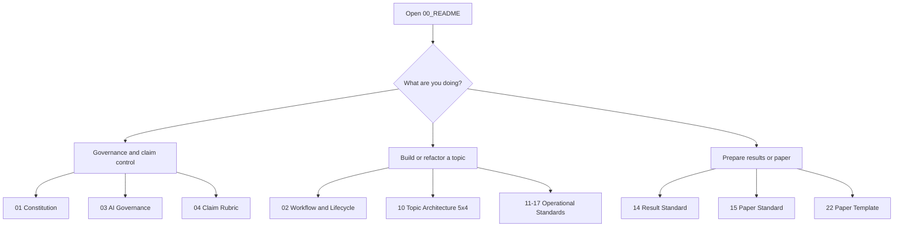

# UET Standards Workspace

<!-- UET-RESEARCH-RETROSPECTIVE: 2026-10-19; navigation notice, not a physics gate -->
> **ทบทวนก่อนวิจัยต่อ — 19 ต.ค. 2026:** ก่อนปรับวิธีวิจัยหรือเริ่ม wave ใหม่ ให้ทบทวนข้อผิดพลาดเดิมและเลือก action ที่เปลี่ยนข้อสรุปได้จริง อ่าน [รายงานข้อผิดพลาดและบทเรียน UET](../../meta/UET_RESEARCH_RETROSPECTIVE.md) โดยเฉพาะข้อ R01–R18 และลำดับแก้ใน §8 ก่อนขยายงาน สถานะจริงยังอ้างอิง artifact/gate ของเส้นทางนั้น

For theory design or stalled multi-branch work, start with
[Theory Development and Research Sequencing v1](32_Theory_Development_and_Research_Sequencing_Standard.md).
Reconstruct accepted ideas and existing evidence, identify the earliest unresolved
dependency of the intended claim, and use one bounded work card before expanding.

New and changed calculation paths use [Calculation and Observation Completeness v1](30_Calculation_and_Observation_Completeness_Standard.md).
Start with the existing scoped contract and coverage inventory before rerunning research.

This folder is the permanent operating standard for UET topic work.

It is not a theory manifesto. It is the place that defines how research work is organized,
reviewed, written, and promoted so the repo stays systematic, auditable, reproducible, and
scientifically legible.

## Authority layers and requirement owners

These layers classify responsibility, NOT scientific grades or readiness states.
The adoption sequence and verified coverage live in [UPDATE_LOG](UPDATE_LOG.md#standards-restructure-w0-w9).

| Layer | Meaning | Canonical home |
| --- | --- | --- |
| A: academic practice | Applicable mathematical, measurement, computational and integrity methods; not a UET discovery or one universal procedure for every discipline | Method-specific requirements in 12-15, 17, 30 and 32, with external sources below |
| B: project operations | Repository paths, review routing, contracts, tooling, templates, logs and publishing | 01-03, 10-11, 16, 18, 20-29; metadata implementations of A in 04, 17, 30, 32 and F0-F8 |
| C: UET propositions | Author-intended hypotheses, adopted definitions, constitutive choices and imported theories; these are objects of investigation, not conditions that results must satisfy | Existing Core ontology/correspondence registry, scoped contracts and topic METHOD/research-design records, NOT this operating manual |
| D: individual studies | One bounded question, selected model, assumptions, inputs, observer/processing chain and results | Existing topic/Core specification, calculation contract, verifier and evidence records |

A file may implement more than one layer. Classify a requirement by its purpose,
not merely its filename. UET hypotheses must never become methodological premises
by being placed in an operating rule. F0-F8 are project review gates, not a new
set of laws of nature; TD0-TD6 are planning stages, not additional gates.

| Requirement family | Single primary owner | Other documents' responsibility |
| --- | --- | --- |
| Governance, preserved failures, human promotion authority | 01 Constitution | Summarize/link, never silently override |
| Topic readiness and transition | 02 Lifecycle | 04 constrains wording; F gates constrain physical acceptance |
| Author intent versus AI additions, reviewer independence | 03 AI Governance | 32 supplies reconstruction method, not inferred author approval |
| Claim classes and evidence-matched public wording | 04 Claim Rubric | Results and manuscripts cite evidence; peer review is not a truth guarantee |
| Folder organization | 10 Topic Architecture 5x4 | 11-16 document their own surfaces, not competing directory rules |
| Runnable-code explanation | 11 Code README | 14 owns result evidence, not 11 |
| Input identity, processing/product lineage | 12 Data Standard | 30 references these identities; do not copy source manifests |
| Bibliographic/source attribution | 13 Reference Standard | Imported laws and comparisons cite their actual source |
| Result identity, metrics, limitations and artifact presentation | 14 Result Standard | 15 consumes evidence; a result file does not grant readiness |
| Manuscript preparation | 15 Paper Standard | 22 is a template, not a new acceptance rule |
| Showcase visualization | 16 Cinematic Viz | Never overrides uncertainty or claim restrictions |
| Formula definitions, units, derivation and constant origin | 17 Formula Audit | Equation registry stores instances; avoid duplicate formula inventories |
| Repeated bounded repair and stop/reopening conditions | 18 Hardening | 24 records outcomes; 25 optimizes routing without selecting physics by queue rank alone |
| AI skill routing and authoring | 26-28 | 27 routes tasks; 29 is a template; skills cannot supersede standards |
| Scoped calculation/measurement completeness | 30 Completeness | 31 is a template; code/schema check structure, not physical adequacy |
| Proposition/model/comparator decision order | 32 Sequencing | One work card in existing study record, not a new tracking registry |
| Physical-equation acceptance requirements | Equation Research and Physical Correspondence / F0-F8 | Preserve the FORMAL/exploratory exception; 30 adds scope-specific measurement evidence |

00 is navigation; UPDATE_LOG records adoption, not scientific state. Templates
20-24, 29 and 31 inherit their owner's rules and cannot introduce requirements
independently. Existing topic records supply layer D; this table does not certify
that all topic records have been reviewed.

### Academic sources and limits

- [JCGM GUM-6:2020](https://www.bipm.org/fr/doi/10.59161/jcgmgum-6-2020): developing and using measurement models; applicable to measurement work, not a demand for instruments in a formal proof.
- [NIST measurement equation guidance](https://physics.nist.gov/cuu/Uncertainty/basic.html): include significant measurement influences and corrections; not a requirement to simulate every degree of freedom.
- [National Academies, Reproducibility and Replicability in Science](https://www.nationalacademies.org/read/25303/chapter/3): distinguish computational reproduction from studies using independently obtained data. Existing repository claim labels remain unchanged pending explicit rubric review.
- [APS Ethics Standards](https://www.aps.org/about/governance/policies-procedures/ethics-standards): integrity and retention of research products, subject to legitimate privacy/legal restrictions.

These sources inform applicable requirements. They do not endorse UET, validate
its models, or make this repository certified to an external standard.

## Purpose

Use this workspace as the first-stop operating manual whenever a topic is being created,
rewritten, audited, or prepared for paper conversion.

## When to use

Use this folder when you need to:

- create a new topic with the correct folder pattern
- repair credibility, evidence, or claim inflation problems
- standardize code, data, references, results, or manuscripts
- onboard a human or AI collaborator into the repo workflow
- decide what document to open next for a specific task

## Workflow summary

## Start Here

1. Read [01_Project_Research_Constitution.md](./01_Project_Research_Constitution.md).
2. Read [02_Project_Workflow_and_Lifecycle.md](./02_Project_Workflow_and_Lifecycle.md).
3. Open the specific operational guide for the pillar you are changing.

## Reading order by task

### If you are creating a new topic

1. [02_Project_Workflow_and_Lifecycle.md](./02_Project_Workflow_and_Lifecycle.md)
2. [10_Topic_Architecture_5x4.md](./10_Topic_Architecture_5x4.md)
3. [11_Code_README_Standard.md](./11_Code_README_Standard.md)
4. [12_Data_Standard.md](./12_Data_Standard.md)
5. [13_Reference_Standard.md](./13_Reference_Standard.md)
6. [14_Result_Standard.md](./14_Result_Standard.md)
7. [17_Formula_Audit_Standard.md](./17_Formula_Audit_Standard.md)
8. [EQUATION_RESEARCH_AND_PHYSICAL_CORRESPONDENCE_STANDARD.md](./EQUATION_RESEARCH_AND_PHYSICAL_CORRESPONDENCE_STANDARD.md)
9. [20_TEMPLATE_README.md](./20_TEMPLATE_README.md)
10. [21_TEMPLATE_ANALYSIS.md](./21_TEMPLATE_ANALYSIS.md)
11. [23_TEMPLATE_FORMULA_AUDIT.md](./23_TEMPLATE_FORMULA_AUDIT.md)

### If you are fixing credibility or integrity issues

1. [01_Project_Research_Constitution.md](./01_Project_Research_Constitution.md)
2. [03_AI_Usage_and_Governance.md](./03_AI_Usage_and_Governance.md)
3. [04_Claim_and_Evidence_Rubric.md](./04_Claim_and_Evidence_Rubric.md)
4. [02_Project_Workflow_and_Lifecycle.md](./02_Project_Workflow_and_Lifecycle.md)
5. [17_Formula_Audit_Standard.md](./17_Formula_Audit_Standard.md)
6. Relevant operational standard in `10-17`

### If you are preparing a paper

1. [04_Claim_and_Evidence_Rubric.md](./04_Claim_and_Evidence_Rubric.md)
2. [14_Result_Standard.md](./14_Result_Standard.md)
3. [15_Paper_Standard.md](./15_Paper_Standard.md)
4. [22_UET_PAPER_TEMPLATE.tex](./22_UET_PAPER_TEMPLATE.tex)

## Standards map

| File | Role | Use it when |
| :-- | :-- | :-- |
| `01_Project_Research_Constitution.md` | highest governance rulebook | you need the non-negotiable principles |
| `02_Project_Workflow_and_Lifecycle.md` | readiness and promotion workflow | you need to place a topic in the correct stage |
| `03_AI_Usage_and_Governance.md` | human-AI collaboration rules | AI is drafting, refactoring, or auditing work |
| `04_Claim_and_Evidence_Rubric.md` | wording and evidence control | a claim feels too strong or too vague |
| `10_Topic_Architecture_5x4.md` | folder architecture | you are laying out or repairing topic structure |
| `11_Code_README_Standard.md` | code documentation standard | you are documenting runnable scripts |
| `12_Data_Standard.md` | provenance and dataset control | a result depends on local or external data |
| `13_Reference_Standard.md` | source and bibliography discipline | references need to constrain claims better |
| `14_Result_Standard.md` | artifact and figure discipline | you are saving outputs or verification artifacts |
| `15_Paper_Standard.md` | manuscript readiness rules | repo work is being converted into a paper |
| `16_Cinematic_Viz_Standard.md` | showcase visualization rules | creating presentation or social demo assets |
| `17_Formula_Audit_Standard.md` | formula, unit, and proof-status control | formulas or constants need provenance and unit review |
| EQUATION_RESEARCH_AND_PHYSICAL_CORRESPONDENCE_STANDARD.md | foundation-first equation workflow | equation meaning, standard-physics matching, units, derivation, verification, or observable mapping is being changed |
| `20_TEMPLATE_README.md` | topic README template | starting or normalizing a topic root README |
| `21_TEMPLATE_ANALYSIS.md` | analysis note template | creating structured technical analysis notes |
| `22_UET_PAPER_TEMPLATE.tex` | manuscript starter | building a paper draft from a mature topic |
| `23_TEMPLATE_FORMULA_AUDIT.md` | formula registry starter | starting a dedicated formula-audit file |
| `18_Research_Hardening_Workflow.md` | repeated repair workflow | narrowing a controlling blocker through auditable hardening waves |
| `24_TEMPLATE_UPDATE_LOG.md` | update log template | recording multi-wave progress without replacing artifacts |
| `25_Research_Throughput_Workflow.md` | token-saving hardening workflow | generating compact wave packets before reading whole topics |
| `26_AI_AGENT_SKILL_MAP.md` | AI skill layer map | deciding which UET-focused skill should support a task |
| `27_AI_AGENT_ROUTING_MATRIX.md` | AI task routing matrix | routing common user requests to the minimum useful skill set |
| `28_AI_AGENT_SKILL_AUTHORING_STANDARD.md` | UET skill authoring rules | creating or reviewing skills without replacing `For Work` |
| `29_TEMPLATE_AI_AGENT_SKILL_SPEC.md` | skill spec template | drafting a portable UET skill before installing it |
| `30_Calculation_and_Observation_Completeness_Standard.md` | scoped model/measurement/error requirements | reviewing calculation paths without confusing metadata coverage with physics |
| `31_TEMPLATE_CALCULATION_CONTRACT.md` | contract template | reusing existing manifest/contract fields instead of per-run paperwork |
| `32_Theory_Development_and_Research_Sequencing_Standard.md` | proposition-to-model-to-test decision order | reconstructing intent, selecting minimal models, comparing existing theories and stopping unproductive expansion; TD stages do not replace F0-F8 |

## Quick decision matrix

| If the problem is... | Open first | Then open |
| :-- | :-- | :-- |
| claim sounds too strong | `04_Claim_and_Evidence_Rubric.md` | `01_Project_Research_Constitution.md` |
| topic structure is messy | `10_Topic_Architecture_5x4.md` | `02_Project_Workflow_and_Lifecycle.md` |
| code exists but nobody knows how to run it | `11_Code_README_Standard.md` | `14_Result_Standard.md` |
| dataset source is unclear | `12_Data_Standard.md` | `04_Claim_and_Evidence_Rubric.md` |
| references are decorative instead of useful | `13_Reference_Standard.md` | `15_Paper_Standard.md` |
| paper draft feels like marketing | `15_Paper_Standard.md` | `04_Claim_and_Evidence_Rubric.md` |
| formula exists but provenance is unclear | `17_Formula_Audit_Standard.md` | `11_Code_README_Standard.md` |
| units or variable meanings are unclear | `17_Formula_Audit_Standard.md` | `02_Project_Workflow_and_Lifecycle.md` |
| AI wrote smooth prose without derivation support | `03_AI_Usage_and_Governance.md` | `04_Claim_and_Evidence_Rubric.md` |
| topic is moving too slowly because blockers are vague | `18_Research_Hardening_Workflow.md` | `02_Project_Workflow_and_Lifecycle.md` |
| many changes happened and progress is hard to track | `24_TEMPLATE_UPDATE_LOG.md` | `18_Research_Hardening_Workflow.md` |
| repeated topic passes are consuming too many tokens | `25_Research_Throughput_Workflow.md` | `18_Research_Hardening_Workflow.md` |
| equation or core operator work is starting before its physical correspondence is closed | EQUATION_RESEARCH_AND_PHYSICAL_CORRESPONDENCE_STANDARD.md | 17_Formula_Audit_Standard.md and the local docs/core/AGENTS.md |
| AI agent needs the right skill or workflow | `27_AI_AGENT_ROUTING_MATRIX.md` | `26_AI_AGENT_SKILL_MAP.md` |
| a new UET-specific Codex skill is being created | `28_AI_AGENT_SKILL_AUTHORING_STANDARD.md` | `29_TEMPLATE_AI_AGENT_SKILL_SPEC.md` |

## Naming pattern

| Range | Meaning |
| :-- | :-- |
| `00-04` | governance and master rules |
| `10-17` | operational standards by work pillar |
| `20-24` | templates and production assets |
| `18` | repeated hardening workflow |
| `24` | durable update-log template |
| `25` | throughput and token-saving workflow |
| `26-29` | AI skill routing, authoring, and portable skill specs |
| `30-32` | calculation completeness, its template and research sequencing |

## Compatibility map

| Old name | New name |
| :-- | :-- |
| `README.md` | `00_README.md` |
| `00_Project_Research_Constitution.md` | `01_Project_Research_Constitution.md` |
| `01_Project_Workflow_and_Lifecycle.md` | `02_Project_Workflow_and_Lifecycle.md` |
| `02_AI_Usage_and_Governance.md` | `03_AI_Usage_and_Governance.md` |
| `03_Claim_and_Evidence_Rubric.md` | `04_Claim_and_Evidence_Rubric.md` |
| `how to topics5x4.md` | `10_Topic_Architecture_5x4.md` |
| `10_Topic_Architecture_5x5(+1).md` | `10_Topic_Architecture_5x4.md` (stale reference, not a second canonical file) |
| `how to Code README.md` | `11_Code_README_Standard.md` |
| `how to Data Standard.md` | `12_Data_Standard.md` |
| `how to Reference Standard.md` | `13_Reference_Standard.md` |
| `how to Result Standard.md` | `14_Result_Standard.md` |
| `how to paper.md` | `15_Paper_Standard.md` |
| `how to Cinematic Viz.md` | `16_Cinematic_Viz_Standard.md` |
| `how to Formula Audit.md` | `17_Formula_Audit_Standard.md` |
| `TEMPLATE_README.md` | `20_TEMPLATE_README.md` |
| `TEMPLATE_ANALYSIS.md` | `21_TEMPLATE_ANALYSIS.md` |
| `UET_PAPER_TEMPLATE.tex` | `22_UET_PAPER_TEMPLATE.tex` |
| `TEMPLATE_FORMULA_AUDIT.md` | `23_TEMPLATE_FORMULA_AUDIT.md` |

## Key rules

- No topic is allowed to outrun its evidence.
- A fit must stay a fit until out-of-sample support exists.
- Internal benchmarks must stay labeled as internal benchmarks.
- Every practical workflow should point to commands, inputs, and outputs.
- Every standards page should be easy to scan, not just correct in prose.
- Every important formula must declare origin, units, and proof status.
- Repository prose must not be promoted from dictation alone; it must be tied to a derivation, script, artifact, or source record.
- Every topic README must make scope, evidence and blockers legible; use a diagram or evidence matrix when it clarifies actual relationships, not as an automatic completion requirement. Apply standard 32's profile rules and reuse existing records.
- Scientific hardening should strengthen the research argument by exposing dependencies, mechanisms, tests, and blockers; it must not collapse the topic into only defensive wording.

## Common failure modes

- governance documents exist but nobody knows reading order
- topic standards are written, but folder naming is still inconsistent
- commands are missing from practical guides, so reruns stop being easy
- diagrams disappear during cleanup, so the docs become harder to navigate
- AI rewrites prose upward without an evidence-based status review
- AI rewrites prose downward without adding diagrams, formula maps, verifier links, or clearer theory structure

## Checklist

- [ ] numbering scheme is used consistently across this folder
- [ ] reading order is clear for common work modes
- [ ] every main standard links to the correct renamed files
- [ ] practical guides contain commands only where they help real execution
- [ ] diagrams and tables exist to support fast scanning
- [ ] topic README templates expose scope/evidence/blockers without irrelevant mandatory graphics or duplicate records
